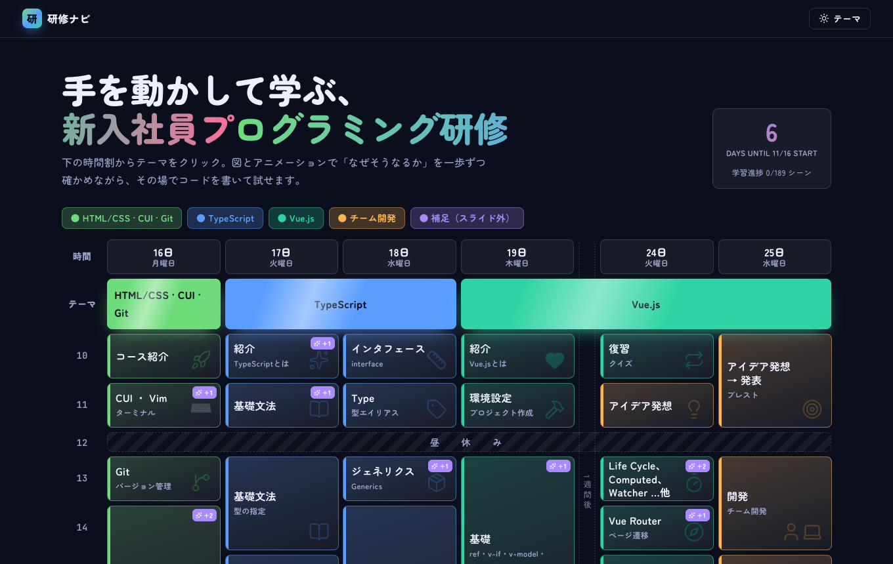
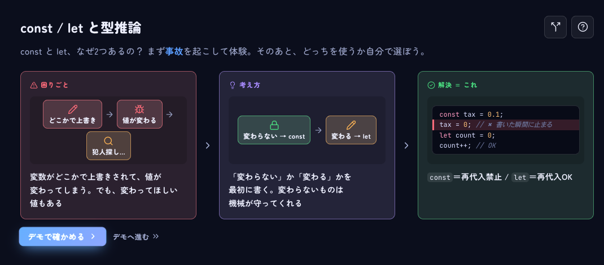
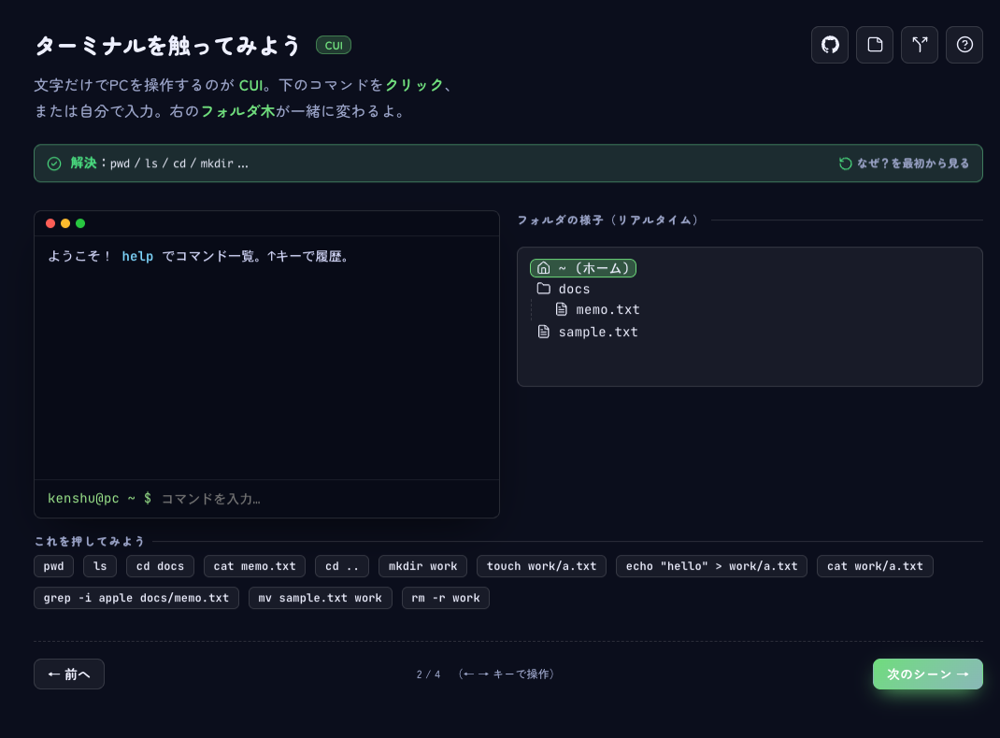
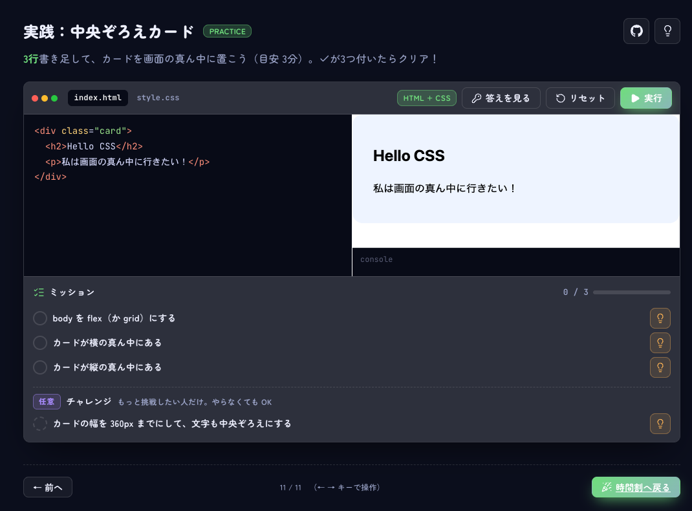

# 📘 研修ナビ

**図とアニメで学ぶ、プログラミング研修**

HTML/CSS ・ CUI ・ Git ・ TypeScript ・ Vue.js

 

## ✨ こんな学び方ができます

<table>
<tr>
<td width="33%" valign="top">
<b>① 困りごと → 考え方 → 解決</b> 
まず「なぜ必要？」を図で見てから、デモで確かめます。  

</td>
<td width="33%" valign="top">
<b>② 触って覚える</b> 
ボタンやキーを押すと、図が動いて仕組みが分かります。  

</td>
<td width="33%" valign="top">
<b>③ 実践でコードを書く</b> 
ミッションは自動でチェック。ヒントも答えもあります。  

</td>
</tr>
</table>

## 🚀 使い方

1. **[ページを開く](https://lamnv612.github.io/kenshu-navi/)** → 時間割のマスをクリック
2. `→` キーで次へ（`←` で戻る）
3. 各ページの右上のアイコンで「使い分け」「ヒント」「GitHub」を開けます

ローカルで使うときは、`index.html` をブラウザで開くだけです（ビルド不要）。

## 📝 メモ

- TypeScript の型チェックと Vue の実行は、インターネット接続が必要です。
- 学習の進み具合は、ブラウザの中に保存されます。
